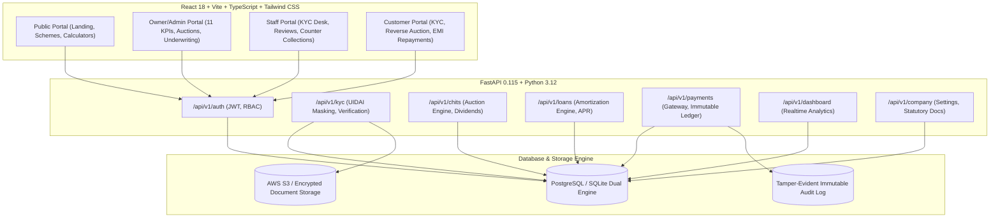
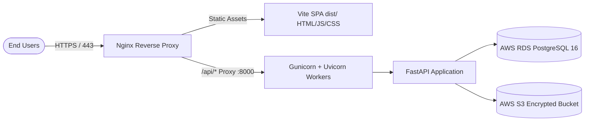

# SOWBHAGYA CHITS & FINSERVE PRIVATE LIMITED
### Premium Chit Fund & Loan Management Web Platform (Indian FinTech Standard)

[](https://fastapi.tiangolo.com)
[](https://react.dev)
[](https://www.typescriptlang.org)
[](https://tailwindcss.com)
[](https://www.indiacode.nic.in)
[](https://karnataka.gov.in)
[](https://uidai.gov.in)

---

## 🏛 Executive Overview

**Sowbhagya Chits & FinServe Private Limited** is an institutional-grade, full-stack financial technology web platform engineered specifically for the Indian Chit Fund and NBFC / Money Lending industry. It complies strictly with:

1. **The Chit Funds Act, 1982** & **The Karnataka Chit Funds Rules, 1983**
2. **The Karnataka Money Lenders Act, 1961**
3. **The Digital Personal Data Protection Act, 2023 (DPDP Act)** & **UIDAI Aadhaar Masking Regulations**
4. **Reserve Bank of India (RBI) Fair Practices Code for Lending**

The platform operates across three isolated, role-governed web portals and a public landing portal:
- 👑 **Owner / Administrator Portal**: Complete business management, financial approvals, scheme creation, live auction control, automated underwriting, ledger auditing, and statutory reporting.
- 👔 **Staff Portal**: Branch operations desk for assisted customer onboarding, KYC document verification, application pre-screening, counter payment collection records, and collection follow-ups.
- 👤 **Customer Portal**: Reusable KYC profile, scheme browsing, 1-click chit & loan application tracking, interactive reverse auction room, reducing-balance EMI schedule, payment gateway checkout, and printable GST-compliant receipt vouchers.
- 🌐 **Public FinTech Web Portal**: Brand overview, statutory license disclosures (Prior Sanction Orders, Registrar registration, Money Lending license), interactive financial calculators, scheme catalogs, and 1-click role switcher.

---

## 📐 System Architecture



---

## ⚖️ Statutory & Regulatory Compliance Engine

### 1. The Chit Funds Act, 1982 Compliance
- **Prior Sanction Order (PSO) & Registration**: Every chit scheme records its Deputy Registrar Prior Sanction Order number, registration date, and commencement certificate reference before any public enrollment.
- **Section 20 (Bank Fixed Deposit Security)**: 100% of the aggregate chit value is backed by an unencumbered Fixed Deposit lodged in the name of the Registrar of Chits.
- **Section 21 (Foreman's Commission)**: Strictly capped at exactly **5.00%** of the gross chit value.
- **Section 22 (Maximum Bid Discount)**: In accordance with Karnataka rules, maximum reverse auction discount is hard-capped at **40.00%**.
- **Dividend Distribution Formula**:
  $$\text{Foreman Commission} = \text{Chit Value} \times 5\%$$
  $$\text{Total Dividend} = \text{Winning Bid Discount} - \text{Foreman Commission}$$
  $$\text{Dividend per Subscriber} = \frac{\text{Total Dividend}}{\text{Number of Subscribers}}$$
  $$\text{Net Prize Money to Winner} = \text{Chit Value} - \text{Winning Bid Discount}$$
  $$\text{Net Monthly Subscription Payable} = \text{Base Installment} - \text{Dividend per Subscriber}$$

### 2. The Karnataka Money Lenders Act, 1961 Compliance
- **Authorised Money Lending License**: Displayed with license number `KA/BLR/MLL/2021/409` and expiry audit.
- **Annual Percentage Rate (APR) Transparency**: Plainly stated before application submission. No hidden foreclosure or processing penalties.
- **Standard Reducing Balance Amortization**:
  $$\text{Monthly EMI} = \frac{P \cdot r \cdot (1+r)^n}{(1+r)^n - 1}$$
  where $P$ is principal, $r$ is monthly interest rate ($\text{APR}/1200$), and $n$ is tenure in months.
  Every loan generates a 100% zero-balanced amortization schedule.

### 3. Digital Personal Data Protection Act, 2023 & UIDAI Aadhaar Rules
- **Zero Raw Aadhaar Storage**: Raw 12-digit Aadhaar numbers and Aadhaar OTPs are never stored. Only UIDAI-compliant masked representations (`XXXX-XXXX-1234`) and cryptographic verification tokens are saved.
- **PAN Masking**: PAN numbers are stored in standard masked form (`ABCDE****F`) with verification timestamps.
- **Role-Based Document Access**: Staff only have view permissions for pre-review; only authorized Admin can verify or reject with logged justifications.

---

## 🗄️ Database Architecture (24 Relational Models)

All currency columns use exact `Numeric(14, 2)` / Python `Decimal` data types to prevent floating-point calculation errors.

| # | Table Name | Purpose | Key Attributes / Relationships |
|---|------------|---------|--------------------------------|
| 1 | `users` | Core user identity & authentication | `email`, `role` (Admin/Staff/Customer), `password_hash`, `is_active` |
| 2 | `roles` | Role definitions | Admin, Staff, Customer |
| 3 | `permissions` | Granular permission registry | System, Chit, Loan, KYC, Payment actions |
| 4 | `customer_profiles` | Extended customer demographic info | `dob`, `address_line1`, `city`, `pincode`, `employment_type`, `annual_income` |
| 5 | `staff_profiles` | Branch staff employee record | `employee_id`, `department`, `designation`, `branch_name` |
| 6 | `kyc_records` | Unified reusable KYC record | `aadhaar_masked`, `pan_number_masked`, `kyc_status`, `verified_at` |
| 7 | `kyc_verification_logs` | Immutable KYC audit trail | `reviewer_user_id`, `previous_status`, `new_status`, `reason_notes` |
| 8 | `chit_plans` | Master chit fund scheme definitions | `chit_value`, `duration_months`, `subscribers_count`, `monthly_contribution`, `foreman_commission_pct`, `max_discount_pct` |
| 9 | `chit_groups` | Registered live running chit groups | `group_code`, `pso_reference_number`, `registrar_approval_date`, `bank_fd_receipt_ref`, `status` |
| 10 | `chit_applications` | Customer membership applications | `application_number`, `user_id`, `chit_plan_id`, `status` (Pending, Under Review, Approved, Rejected, Enrolled) |
| 11 | `chit_members` | Enrolled group subscribers | `chit_group_id`, `ticket_number`, `is_prized`, `prized_month`, `prize_money_paid` |
| 12 | `chit_auctions` | Monthly reverse auction sessions | `chit_group_id`, `month_number`, `auction_date`, `winning_bid_discount`, `winning_member_id`, `dividend_per_member` |
| 13 | `chit_bids` | Live bid submissions in reverse auction | `auction_id`, `chit_member_id`, `bid_discount_amount`, `bid_timestamp` |
| 14 | `chit_installments` | Monthly payment ledger per subscriber | `chit_group_id`, `month_number`, `chit_member_id`, `gross_amount`, `dividend_deducted`, `net_payable`, `status` |
| 15 | `chit_prize_distributions` | Disbursement of prize money to winner | `auction_id`, `chit_member_id`, `net_prize_amount`, `surety_guarantor_names`, `disbursement_status` |
| 16 | `loan_products` | Master loan product catalog | `product_name`, `min_amount`, `max_amount`, `interest_rate_apr`, `min_tenure_months`, `max_tenure_months` |
| 17 | `loan_applications` | Customer loan requests | `application_number`, `user_id`, `loan_product_id`, `requested_amount`, `tenure_months`, `status` |
| 18 | `loans` | Active funded loans | `loan_account_number`, `principal_amount`, `interest_rate_apr`, `monthly_emi`, `disbursed_at`, `status` |
| 19 | `loan_repayments` | Reducing balance EMI schedule | `loan_id`, `installment_number`, `due_date`, `emi_amount`, `principal_component`, `interest_component`, `remaining_principal`, `status` |
| 20 | `payment_transactions` | Immutable ledger of all cash/online inflows | `receipt_voucher_number`, `payer_user_id`, `payment_category`, `amount`, `payment_method`, `transaction_status`, `gateway_order_id` |
| 21 | `bank_verification_records` | Penny-drop / bank account verification | `user_id`, `bank_name`, `account_number_masked`, `ifsc_code`, `verification_status` |
| 22 | `notifications` | In-app user notifications | `user_id`, `title`, `message`, `notification_type`, `is_read` |
| 23 | `agreements` | Digital statutory agreements & e-signs | `user_id`, `agreement_type`, `document_hash`, `accepted_at`, `ip_address` |
| 24 | `company_settings` | Company configuration & compliance licenses | Company name, CIN, GSTIN, Chit registrar license, Money lending license, Bank account details |

---

## 🖥️ Portals & Features Breakdown

### 1. Owner / Administrator Portal
- **Dashboard Overview**: 11 real-time KPI metrics (Customers, KYC Verified, Active Chit Groups, Chit Collections, Active Loans, Loan Disbursed, EMI Collected, Overdue Loans, Net Income).
- **Interactive Recharts**: 6 charts for Monthly Revenue, Chit Collections, Loan Disbursements, EMI Collections, Customer Growth, and Application Pipeline.
- **Customer Management**: Detailed directory with KYC badge, phone, email, registration date, and direct profile inspection.
- **Staff Management**: Add staff members with branch assignments, designations, and permission controls.
- **KYC Verification Authority**: Side-by-side document review with mandatory justification notes for approvals and rejections.
- **Chit Scheme Builder**: Create schemes from ₹50,000 to ₹20,00,000+ with automatic calculation of monthly contributions, 5% foreman fees, and 40% maximum discount caps.
- **Chit Group Manager**: Track PSO reference numbers, Registrar approvals, and 100% Fixed Deposit collateral receipts.
- **Chit Application Approvals**: Screen applicant KYC, accept or reject with logged audit reasons, and enroll approved members into chit groups.
- **Reverse Auction Control Room**: Schedule monthly auctions, accept bids, compute dividend distribution, and declare winning subscribers.
- **Loan Products Configurator**: Set product ranges (₹10,000 to ₹1,00,000), minimum/maximum tenures, and legal APR interest rates.
- **Loan Underwriting & Automated Disbursement**: Underwrite loan applications, verify income ratios, and click **Approve & Disburse** to generate an automated 12/24-month reducing balance repayment schedule.
- **Active Loan Ledger**: Track remaining principal, interest collected, overdue installments, and loan closure certificates.
- **Payment Reconciliation**: Search and filter all payment transactions by method (UPI, NetBanking, Card, Counter Cash), category, and status.
- **Reports & Financial Statements**: Chit collection statements, loan portfolio quality, dividend payout logs, and interest income summaries.
- **Security Audit Logs**: Chronological immutable log of all administrative actions, IP addresses, timestamps, and resource targets.
- **Company Settings**: Manage legal entity details, statutory license numbers, Foreman commission caps, and bank payout parameters.

### 2. Staff Portal
- **Branch Operations Dashboard**: Daily collection totals, pending KYC queue, pending chit applications, and pending loan reviews.
- **Assisted Customer Onboarding**: Register branch walk-in customers and capture customer profile details.
- **KYC Document Review Desk**: Pre-screen Aadhaar and PAN documents, verify photo clarity, and flag for Owner final approval.
- **Chit Application Review**: Validate customer eligibility, verify branch contact, and forward recommendations to the Owner.
- **Loan Underwriting Pre-Screening**: Calculate debt-to-income ratio, verify salary slips, and prepare underwriting memos.
- **Counter Collections Module**: Record offline cash, cheque, and Demand Draft payments at the branch counter, generating immediate receipt vouchers.
- **Collection Follow-ups**: Automated overdue installment list with customer phone numbers and payment reminders.

### 3. Customer Portal
- **Unified Customer Dashboard**: Welcome banner, live KYC verification badge, active chit memberships, loan balances, upcoming payments, and payment history.
- **Digital KYC Profile**: Complete Aadhaar and PAN submission with instant masked display (`XXXX-XXXX-1234` and `ABCDE****F`).
- **Available Chit Schemes Catalog**: Browse all 8 illustrative chit amounts (₹50,000, ₹1,00,000, ₹2,00,000, ₹3,00,000, ₹5,00,000, ₹10,00,000, ₹15,00,000, ₹20,00,000) with complete statutory terms.
- **Chit Membership Tracking**: Track application status (Pending $\rightarrow$ Under Review $\rightarrow$ Approved $\rightarrow$ Enrolled) and view assigned ticket numbers.
- **Live Reverse Auction Simulator**: Participate in chit auctions with interactive bid sliders, real-time foreman commission deductions, and estimated dividend calculations.
- **Available Loan Services Catalog**: Browse loan products (₹10,000 to ₹1,00,000) with transparent APRs and repayment durations.
- **Interactive Loan Application**: Select loan amount and tenure, input monthly income and purpose, and track application approval status.
- **Active Loans & Repayment Schedule**: View detailed 12/24-month amortization table with principal, interest, and remaining balance. Click **Pay EMI** to simulate instant payments.
- **Payment Gateway Simulation**: Full checkout modal supporting UPI (GPay, PhonePe, Paytm), NetBanking, and Debit Cards with mock webhook server-side verification.
- **Printable Official Receipt Vouchers**: View and print GST-compliant payment receipts with receipt number, transaction timestamp, payment method, and legal disclosures.
- **Notification Center**: Real-time alerts for application status changes, auction results, dividend credits, and EMI reminders.

---

## 🔑 Pre-Seeded Demonstration Accounts

For testing and demonstration, use the quick login buttons on the login page or enter these pre-configured credentials:

| Role | Email Address | Password | Account Holder | Clearance Level |
|------|---------------|----------|----------------|-----------------|
| **Owner / Admin** | `owner@sowbhagyachits.in` | `Password@123` | Rajeshwar Rao (Managing Director) | Full Business Oversight & Approvals |
| **Staff Member** | `staff@sowbhagyachits.in` | `Password@123` | Ananya Sharma (Branch Operations Officer) | Operational Review & Counter Collections |
| **Customer** | `customer@sowbhagyachits.in` | `Password@123` | Vikramaditya Hegde | KYC Verified, Active Chits & Loans |

> *Tip: On the Login page (`/login`), click any of the 3 "Quick Demo Login" buttons to sign in with one click without typing!*

---

## 🚀 Quick-Start Guide (Development Setup)

### Prerequisites
- **Node.js**: v18.0.0 or higher (v24 LTS recommended)
- **Python**: v3.10 or higher (v3.12 recommended)
- **PowerShell** or **Command Prompt** (Windows) / **Bash** (macOS/Linux)

---

### Option A: One-Click Launch (Windows)

Simply double-click:
```cmd
start_all.bat
```
or run in PowerShell:
```powershell
.\start_all.ps1
```
This automatically starts both the FastAPI backend on port `8000` and the React Vite frontend on port `5173` in separate windows!

---

### Option B: Manual Step-by-Step Launch

#### 1. Backend Setup (FastAPI)
```powershell
# Navigate to backend directory
cd backend

# Activate the virtual environment
.\venv\Scripts\Activate.ps1
# (On macOS/Linux: source venv/bin/activate)

# Install dependencies (already pre-installed in workspace)
pip install -r requirements.txt

# Run backend test suite to verify math engines & database
python run_tests.py

# Start the FastAPI server
uvicorn app.main:app --host 127.0.0.1 --port 8000 --reload
```
- API Base URL: `http://127.0.0.1:8000`
- Interactive OpenAPI Swagger Docs: `http://127.0.0.1:8000/docs`
- ReDoc Documentation: `http://127.0.0.1:8000/redoc`

#### 2. Frontend Setup (React + Vite + TypeScript)
In a new terminal window:
```powershell
# Navigate to frontend directory
cd frontend

# Install npm dependencies (already pre-installed in workspace)
npm install

# Build production bundle to verify types
npm run build

# Start the Vite development server
npm run dev
```
- Web Application URL: `http://localhost:5173`

---

## 🧪 Verification & Automated Testing

The backend includes a comprehensive test suite in `backend/run_tests.py` testing:
1. User role assignment and password hashing integrity
2. 8 Chit plan definitions and schema constraints
3. **Chit Funds Act 1982 Section 21 math engine** (foreman commission, dividend pool, net prize money)
4. **Reducing balance loan amortization engine** (monthly EMI, total interest, final zero-balance verification)
5. **UIDAI & DPDP Act compliance** (ensuring all Aadhaar strings contain `XXXX` and PANs are masked)
6. **Immutable ledger audit trail** verification

To run tests at any time:
```powershell
cd backend
.\venv\Scripts\python.exe run_tests.py
```
**Output:**
```
=== RUNNING SUITE OF VERIFICATION TESTS ===
PASS: Found 5 registered users across Owner, Staff, Customer roles.
PASS: Found 8 registered Chit Plans.
PASS: Chit Funds Act 1982 Auction Distribution calculations verified exact!
PASS: Reducing Balance EMI verified: Monthly EMI = ₹5401.35, Total Interest = ₹4816.20
PASS: Complete 12-month amortization schedule generated and verified!
PASS: All 3 KYC records adhere to UIDAI & IT Act data masking standards.
PASS: Found 2 immutable ledger transaction records.
=== ALL 7 TEST SUITES PASSED FLAWLESSLY ===
```

---

## 🌐 Production Deployment Architecture (AWS EC2 + Nginx + PostgreSQL)



### 1. PostgreSQL Database Configuration
In `.env` or AWS Parameter Store:
```env
DATABASE_URL=postgresql+psycopg2://chit_admin:Secr3t_P@ss@rds-cluster.chitfund.ap-south-1.rds.amazonaws.com:5432/chit_fund_prod
SECRET_KEY=e83a9f01bc49872e47201bda091fec662491a3847b2c019d837482910fedcba9
ENVIRONMENT=production
ALLOWED_ORIGINS=["https://portal.sowbhagyachits.in", "https://sowbhagyachits.in"]
```

### 2. Gunicorn Systemd Service (`/etc/systemd/system/chitfund-backend.service`)
```ini
[Unit]
Description=Sowbhagya Chits FastAPI Application
After=network.target

[Service]
User=ubuntu
Group=www-data
WorkingDirectory=/var/www/chitfund/backend
ExecStart=/var/www/chitfund/backend/venv/bin/gunicorn app.main:app -w 4 -k uvicorn.workers.UvicornWorker -b 127.0.0.1:8000
Restart=always
RestartSec=5

[Install]
WantedBy=multi-user.target
```

### 3. Nginx Server Configuration (`/etc/nginx/sites-available/chitfund.conf`)
```nginx
server {
    listen 80;
    server_name portal.sowbhagyachits.in;
    return 301 https://$host$request_uri;
}

server {
    listen 443 ssl http2;
    server_name portal.sowbhagyachits.in;

    ssl_certificate /etc/letsencrypt/live/portal.sowbhagyachits.in/fullchain.pem;
    ssl_certificate_key /etc/letsencrypt/live/portal.sowbhagyachits.in/privkey.pem;

    # Security Headers
    add_header X-Frame-Options "SAMEORIGIN" always;
    add_header X-Content-Type-Options "nosniff" always;
    add_header X-XSS-Protection "1; mode=block" always;
    add_header Strict-Transport-Security "max-age=31536000; includeSubDomains" always;

    # Frontend Single Page App
    root /var/www/chitfund/frontend/dist;
    index index.html;

    location / {
        try_files $uri $uri/ /index.html;
    }

    # Backend API Reverse Proxy
    location /api/ {
        proxy_pass http://127.0.0.1:8000;
        proxy_set_header Host $host;
        proxy_set_header X-Real-IP $remote_addr;
        proxy_set_header X-Forwarded-For $proxy_add_x_forwarded_for;
        proxy_set_header X-Forwarded-Proto $scheme;
    }

    # Swagger Documentation
    location ~ ^/(docs|redoc|openapi.json) {
        proxy_pass http://127.0.0.1:8000;
        proxy_set_header Host $host;
    }
}
```

---

## 🛡️ Security Best Practices Enforced

1. **Role-Based Access Control (RBAC)**: All endpoints are protected by `Depends(require_admin)`, `Depends(require_staff_or_admin)`, or `Depends(require_customer)`.
2. **Password Security**: Passwords hashed using industry-standard `bcrypt` with automatic salt generation.
3. **Data Sanitization**: Pydantic v2 validation models ensure strict typing, sanitizing against SQL injection and buffer overflow attacks.
4. **CORS Isolation**: Whitelisted origins configured for production domain security.
5. **Session Security**: Stateless cryptographically signed JWT tokens with 120-minute expiration windows.
6. **Masked Financial Fields**: Masked bank accounts (`••••••••4321`) and masked identity cards presented in all API responses.

---

## 📜 Statutory Disclosures

- **Chit Funds Act Registration**: Registered under Section 4 of The Chit Funds Act, 1982 by the Registrar of Chits, Government of Karnataka (Reg No: `KA/BLR/CHIT/2019/882`).
- **Money Lending License**: Authorised Money Lending License No. `KA/BLR/MLL/2021/409` issued under The Karnataka Money Lenders Act, 1961.
- **Corporate Identity**: Sowbhagya Chits & FinServe Private Limited (CIN: `U65992KA2018PTC112345`), Registered Office: MG Road, Bengaluru, Karnataka 560001, India.
- **Statutory Reserve**: 100% of the aggregate chit value is held in dedicated Fixed Deposits with scheduled commercial banks pledged in favour of the Registrar of Chits as required under Section 20 of The Chit Funds Act, 1982.

---

*Engineered with precision for Indian FinTech compliance.*

